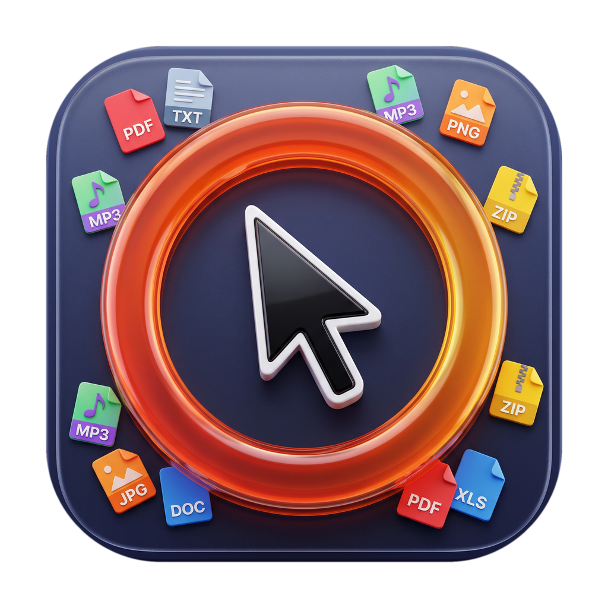

  
  <h1>Converze</h1>
  
<strong>Instant radial wheel file converter for macOS & Windows.</strong>

  
Hold <code>⌥ Option</code> (macOS) or <code>Alt</code> (Windows) + Left-Click any file to convert it on the spot.

---

## Overview

**Converze** is a lightweight, native background utility that lets you convert files in a single gesture. Everything runs **100% locally** on your device with zero cloud uploads and no file size limits.

  
  

  

---

## How it works

1. **Hold the shortcut key** — Hold **`⌥ Option`** in macOS or **`Alt`** in Windows.
2. **Click or drag a file** — Left-click or drag any selected file to open the radial wheel right under your cursor.
3. **Pick a format** — Click or release on the target format slice (`WEBP`, `PNG`, `PDF`, `MP4`, `MP3`, `ZIP`, etc.). The converted file is saved immediately next to the original.
4. **Quick dismiss** — Press **`ESC`** or click anywhere outside the wheel to close it.

---

## Settings & Customization

Converze includes **Light Mode**, **Dark Mode**, **System Auto**, **6 color palettes** (*Sapphire, Indigo, Emerald, Cyan, Amethyst, Rose*), and full **English & Romanian** language support.

  
  
  

---

## Supported Formats (275 Conversion Paths)

| Category | Input Formats | Output Formats |
| :--- | :--- | :--- |
| **Images** | `JPG`, `PNG`, `WEBP`, `HEIC`, `AVIF`, `TIFF`, `BMP`, `ICO`, `SVG`, `GIF`, `RAW` | `WEBP`, `PNG`, `JPG`, `AVIF`, `HEIC`, `PDF`, `ICO`, `BMP`, `TIFF` |
| **Video** | `MP4`, `MOV`, `MKV`, `WEBM`, `AVI`, `M4V`, `WMV`, `FLV`, `MPEG`, `TS` | `MP4`, `MOV`, `WEBM`, `GIF`, `MKV`, `AVI`, `MP3`, `WAV` |
| **Audio** | `MP3`, `WAV`, `M4A`, `FLAC`, `AAC`, `OGG`, `OPUS`, `WMA`, `AIFF` | `MP3`, `WAV`, `M4A`, `FLAC`, `AAC`, `OGG`, `OPUS`, `AIFF` |
| **Documents & PDF** | `PDF`, `DOCX`, `DOC`, `ODT`, `RTF`, `TXT`, `MD`, `HTML`, `EPUB` | `PDF`, `DOCX`, `TXT`, `MD`, `HTML`, `RTF`, `PNG`, `JPG` |
| **Spreadsheets** | `XLSX`, `XLS`, `ODS`, `CSV`, `TSV`, `JSON` | `CSV`, `XLSX`, `JSON`, `PDF`, `HTML`, `MD` |
| **Presentations** | `PPTX`, `PPT`, `ODP`, `KEY` | `PDF`, `PPTX`, `PNG`, `JPG` |
| **Subtitles** | `SRT`, `VTT`, `ASS`, `SSA`, `SUB` | `SRT`, `VTT`, `TXT`, `ASS` |
| **Archives** | Folders, `ZIP`, `TAR`, `GZ`, `TGZ`, `7Z`, `RAR` | `ZIP`, `TAR`, `GZ`, `7Z` |

---

## Download

Download is available under the RELEASE tab, for macOS and Windows. Both are compiled and ready to use.

---
